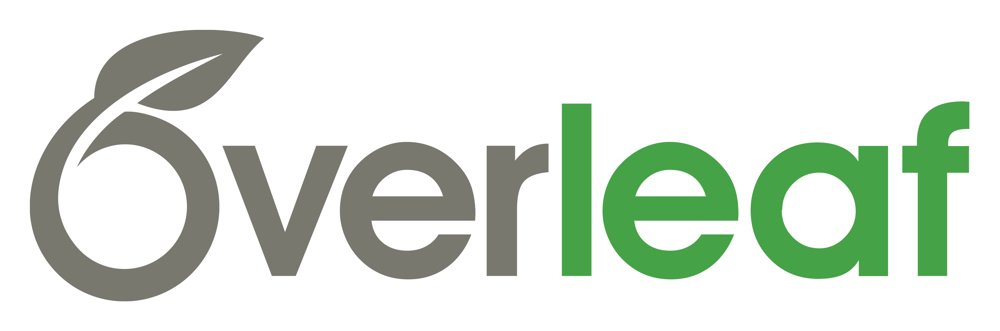

<h1 align="center">
  <br>
  <a href="https://github.com/codemolabs/overleaf"></a>
</h1>

<h4 align="center">Enhanced Open-Source Collaborative LaTeX Editor with Native Host Storage & Real-Time Sync</h4>

<p align="center">
  <b>Maintained by <a href="https://github.com/codemolabs">Codemo Open Source Labs (COSL)</a></b> • Part of the Codemo Teams Ecosystem
</p>

<p align="center">
  <a href="#key-features">Key Features</a> •
  <a href="#quickstart">Quickstart</a> •
  <a href="#local-folder-sync">Local Sync Architecture</a> •
  <a href="docs/LOCAL_FOLDER_SYNC.md">Sync Docs</a> •
  <a href="docs/COSL_MAINTENANCE.md">COSL Maintenance</a> •
  <a href="#contributing">Contributing</a> •
  <a href="#license">License</a>
</p>

---

## About COSL Overleaf

**COSL Overleaf** is an enhanced, production-ready distribution of Overleaf Community Edition maintained by [Codemo Open Source Labs (COSL)](https://github.com/codemolabs).

While upstream Overleaf Community Edition provides a web-based collaborative editor, user projects and compiled artifacts have historically been locked inside internal Docker volumes and database blobs. COSL Overleaf bridges this divide by delivering a **native, secure, real-time host storage engine**, giving developers, researchers, and students full, direct access to their LaTeX files on their local disks.

---

## Key Features

- 📁 **Native Host Folder Synchronization**:
  - Automatically syncs project files (`.tex`, `.bib`, figures, assets) directly to the host machine.
  - Automatically persists the freshly compiled `.pdf` output to disk upon successful LaTeX compilation.
- 🎯 **Flexible Path Configuration**:
  - Set a global default base directory (e.g. `~/OverleafProjects/`) for all projects.
  - Set custom local folder overrides per project directly from the web interface.
- 🔒 **Enterprise-Grade Security Sandbox**:
  - Prevents path traversal (`../`) and rejects restricted system folders (`/etc`, `/boot`, `/usr`, `~/.ssh`).
  - Resolves symlinks to eliminate symlink jailbreak vulnerabilities.
  - Prevents directory collisions across multiple projects.
  - **Zero Data Loss Guarantee**: Employs a manifest file (`.overleaf-sync.json`) so only Overleaf-tracked files are synced; personal files placed into the folder are strictly preserved.
- 🎨 **Seamless Dashboard Integration**:
  - Modern project list banner with one-click path copying and full-library "Sync All" triggers.
  - Interactive host directory picker with built-in folder creation modal.
  - Folder status badges and action menu options on every project card.
- 📦 **Complete Scientific LaTeX Toolchain**:
  - Pre-packaged with complete TeX Live packages, IEEE templates, and standard citation formats.

---

## Quickstart

### Running with Overleaf Toolkit

COSL Overleaf connects directly with [Overleaf Toolkit](https://github.com/overleaf/toolkit):

1. **Configure Image in `config/overleaf.rc`**:
   ```bash
   OVERLEAF_IMAGE_NAME=codemolabs/overleaf:latest
   ```

2. **Mount Host User Storage in `config/docker-compose.override.yml`**:
   ```yaml
   services:
     sharelatex:
       volumes:
         - /home/uzairserver:/home/uzairserver:rw
   ```

3. **Start the Stack**:
   ```bash
   bin/up
   ```

4. Open `http://localhost/project` in your browser. Configure your default base storage directory or project custom folders directly in the dashboard!

---

## Local Folder Sync Architecture

COSL Overleaf integrates a high-performance internal microservice daemon (`@overleaf/local-sync`) running under `runit` inside the container:

```
[ Web UI (React) ] 
       │
       ▼
[ Web Backend (Express/Node) ]
       │  (LocalProjectSyncManager)
       ▼
[ Unix Domain Socket: /run/overleaf-local-sync/sync.sock ]
       │
       ▼
[ local-sync Daemon (uid:1000 gid:1000) ]
       │  (Atomic writes, manifest tracking, path validation)
       ▼
[ Host Filesystem: /home/uzairserver/OverleafProjects/<Project>/ ]
  ├── main.tex
  ├── references.bib
  ├── output.pdf
  └── .overleaf-sync.json
```

For complete technical specifications, see [docs/LOCAL_FOLDER_SYNC.md](docs/LOCAL_FOLDER_SYNC.md).

---

## COSL Maintenance & Governance

COSL Overleaf is governed by the standards of [Codemo Open Source Labs](https://github.com/codemolabs/.github):

- **Repository**: `codemolabs/overleaf`
- **Maintenance Guide**: [docs/COSL_MAINTENANCE.md](docs/COSL_MAINTENANCE.md)
- **Security Policy**: Consult our [Security Policy](https://github.com/codemolabs/.github/blob/main/SECURITY.md) and report issues to `cosl@codemoteams.org`.

---

## Contributing

We welcome contributions! Please review [CONTRIBUTING.md](CONTRIBUTING.md) and our [Code of Conduct](https://github.com/codemolabs/.github/blob/main/CODE_OF_CONDUCT.md).

---

## License

COSL Overleaf is free open-source software licensed under the **GNU Affero General Public License v3.0 (AGPL-3.0)**. See [`LICENSE`](LICENSE) for details.
