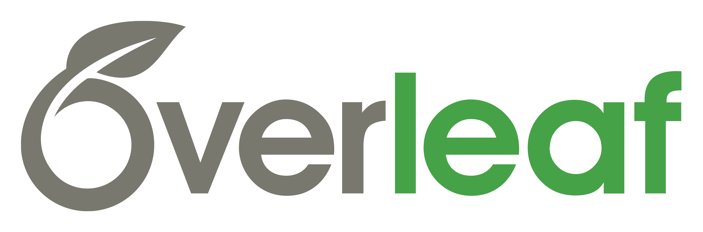

<div align="center">



# Overleaf: COSL Contributions and Engineering Notes

Codemo Open Source Labs (COSL) engineering documentation for our Overleaf Community Edition fork, maintained for upstream pull requests to Overleaf and as the collaborative LaTeX foundation for RISE.

<table align="center">
  <tr>
    <td align="center" width="130">
      <br/>
      <b>Linux</b>
    </td>
    <td align="center" width="130">
      <br/>
      <b>macOS</b>
    </td>
    <td align="center" width="130">
      <br/>
      <b>Windows</b>
    </td>
  </tr>
</table>

</div>

## Overview

The root [README.md](README.md) in this fork is kept identical to upstream `overleaf/overleaf` so upstream pull requests stay clean and follow Overleaf's repository conventions. All COSL additions, architectural notes, and operational guides live in this document and under `docs/`.

Every feature added here uses Overleaf's native React components, SCSS tokens, Express and Mongoose patterns, and container init model. This keeps changes modular for pull requests to `overleaf/overleaf`, while giving RISE a low-memory self-hosted LaTeX engine for laptops, lab servers, and private networks.

## Chronological Change History and Architecture

The changes below are listed in the order they were built and refined on top of Overleaf Community Edition.

### 1. Native Host Folder Storage and Local Sync Daemon

Standard Overleaf Community Edition stores project source trees inside MongoDB, Redis, and blob storage. For developers using local Git workflows, VS Code, or offline reference tools, extracting files requires manual downloads or external bridges.

We added `@overleaf/local-sync` under `services/local-sync/` as a separate runit daemon (`server-ce/runit/local-sync/run`). The `web` service forwards sync requests over an internal Unix domain socket (`/run/overleaf-local-sync/sync.sock`) because letting `web` write directly would stamp host files as `www-data`. Running the daemon under the workstation UID/GID preserves host file ownership.

Key mechanisms:
- **Path confinement and symlink checks**: `services/local-sync/path-utils.mjs` and `services/web/app/src/Features/Project/LocalProjectSyncPathUtils.mjs` canonicalize every target directory with `fs.realpathSync` and confine writes under `LOCAL_SYNC_ALLOWED_ROOT`. System directories (`/etc`, `/var`, `/usr`, `/root`, `~/.ssh`, `~/.gnupg`) and toolkit directories are blocked.
- **Collision protection and safe stale cleanup**: No two Overleaf projects may target the same host folder. Each synced folder stores a `.overleaf-sync.json` manifest recording files managed by Overleaf so deletes or renames clean up tracked files without touching personal local files (such as `.git`, local scripts, or notes).
- **Event-driven hooks**: `TpdsUpdateSender.mjs` triggers synchronization on doc saves, file uploads, and renames, while `CompileController.mjs` copies compiled PDFs next to `.tex` sources after successful builds.
- **Dashboard integration**: `LocalProjectSyncManager.mjs`, `LocalProjectSyncController.mjs`, and React modals under `services/web/frontend/js/features/project-list/components/local-folder/` provide a directory browser, folder creation, base folder settings, per-project overrides, and row badges for custom/paused/error states.

### 2. Package Hub Service and Offline TeX Management

Managing missing LaTeX classes and `.sty` packages inside containerized Overleaf usually requires shell access and manual `tlmgr` runs inside `sharelatex`. We introduced `@overleaf/package-hub` (`services/package-hub/`) so administrators and workspace users can inspect installed TeX Live packages, search upstream CTAN/community sources, and upload custom `.sty`/`.cls` packages from `/packages`.

How it works:
1. A dedicated runit service (`server-ce/runit/package-hub/run`) listens on `/run/overleaf-package-hub/hub.sock` and executes `tlmgr` archives, checksum verification, and `texhash` inside `texmf-local`.
2. `job-queue.mjs` serializes TeX installations so parallel clicks cannot corrupt the TeX Live database (`texlive.tlpdb`).
3. `security-utils.mjs` validates package names, rejects shell metacharacters, and inspects uploaded archives to block zip-slip path traversal before extraction.
4. State and history are stored in MongoDB via `PackageHubPackage.mjs`, `PackageHubManifest.mjs`, `PackageHubJob.mjs`, and `PackageHubAuditLog.mjs`, proxied through `PackageHubController.mjs` and `PackageHubManager.mjs` behind session auth and CSRF tokens.

### 3. First-Time Launchpad Onboarding and Headless Bootstrap

On clean installs where zero admin accounts exist, upstream Community Edition dropped visitors on `/login` with no active administrator. We updated `HomeController.mjs`, `LaunchpadController.mjs`, `UserPagesController.mjs`, and `modules/launchpad/app/views/launchpad.pug` so `/` routes automatically to `/launchpad` when zero admin users exist, and redirects to `/login` once the admin setup completes.

For automated deployments and CI, `server-ce/init_scripts/920_bootstrap_admin.sh` and `services/web/modules/launchpad/app/src/bootstrap-admin.mjs` optionally seed the initial administrator from `OVERLEAF_ADMIN_EMAIL` and `OVERLEAF_ADMIN_PASSWORD` when the database has no admins yet. User profiles in `User.mjs`, `UserController.mjs`, and account settings also store optional `role` and `institution` fields used later by enterprise access policies.

### 4. Enterprise System Admin Console Redesign

Overleaf Community Edition exposes SaaS-oriented admin tabs (such as site management and debug object lookup) that fail or have no backend meaning on a single self-hosted server. We removed those SaaS-only paths from `layout-react.pug`, `navbar-marketing.pug`, and React navbar menus when `hasFeature('saas')` is disabled, removed Digital Science footer branding from CIAM and marketing templates, and rebuilt `/admin` using Overleaf's native panel styling (`services/web/frontend/js/features/admin/`).

`AdminController.mjs` and `AdminService.mjs` back four tabs with Zod schema validation:
- **Overview**: Live database counts plus `local-sync` and `package-hub` daemon health.
- **Users**: Account creation, role/institution assignment, admin toggling, and cleanup.
- **Project Access**: Centralized view of all workspace projects, user-to-user shares, and admin-managed network policies.
- **Settings & Maintenance**: System banners, editor open/closed toggles, TeX storage paths, and custom organization branding.

### 5. Enterprise Project Access Policies and Unified Native Sharing

Self-hosted labs often need three sharing patterns in parallel: keeping drafts private, sharing projects directly between specific users with read-only, edit, or copy access, and publishing curated templates or shared labs across an internal network or role group.

We extended Overleaf's native `ShareProjectModal` workflow across the editor toolbar, project dashboard row menus, and `/admin`, adding an enterprise access block (`enterprise-access-section.tsx`) backed by `ProjectAccessPolicyService.mjs` and `ProjectSharingController.mjs`:
- `VALID_ENTERPRISE_SCOPES` defines four scopes: `private`, `network`, `all_users`, and `custom` (targeting specific roles, institutions, or user emails).
- `VALID_PERMISSION_MODES` defines `edit`, `copy`, and `view_only`, paired with an `allowCopy` flag that feeds into `CopyProjectButton` and `ProjectController.mjs`.
- `DEFAULT_NETWORK_CIDRS` restricts `network` scope by default to private RFC 1918 and loopback CIDR ranges (`127.0.0.0/8`, `10.0.0.0/8`, `172.16.0.0/12`, `192.168.0.0/16`, `169.254.0.0/16`, `::1/128`, `fc00::/7`, `fe80::/10`) evaluated in `AsyncLocalStorage` request context.
- Direct user-to-user shares remain visible to project collaborators and audited in `/admin`, while non-collaborator users cannot list or access another user's private share.

### 6. Dashboard Cleanup and Single-Project Organize Tags

Earlier dashboard additions placed redundant Package Hub and base folder banners in the header and rendered a warning footer banner on `/project`. We removed `local-folder-banner.tsx` and the duplicate top navbar Package Hub item, moved "Folder Location" cleanly into the left sidebar footer switcher (`sidebar-ds-nav.tsx`) and navigation dropdown, and removed the warning banner from `thin-footer.tsx`.

Users could organize tags across multi-selected projects from the toolbar, but a single row's three-dot action menu lacked that action. We added `OrganizeTagsProjectButton` (`services/web/frontend/js/features/project-list/components/table/cells/action-buttons/organize-tags-project-button.tsx`) inside `actions-dropdown.tsx` right below `RenameProjectButton`, opening a modal to toggle existing tags or create new tags via Overleaf's existing tag API (`createTag`, `addProjectsToTag`, `removeProjectFromTag`). We also fixed a duplicate DOM ID collision where upstream `tags-dropdown.tsx` shared `id="project-tools-more-dropdown"` with the toolbar's More button, assigning it `id="project-tools-tags-dropdown"`.

### 7. Network-Wide Organization Logo

Administrators can replace Overleaf's default navbar and login logo across the entire instance from `/admin` under Settings & Maintenance without editing container files or rebuilding webpack bundles.

Mechanism in `WorkspaceBrandingService.mjs`:
1. `PUT /api/admin/branding` accepts PNG, JPEG, WebP, or sanitized SVG payloads up to 512 KB plus an optional `organizationName`, for light and optional dark variants.
2. Uploaded buffers are checked by file signature magic bytes (PNG `89 50 4E 47`, JPEG `FF D8 FF`, WebP `RIFF...WEBP`). SVG inputs are rejected with HTTP 400 if they contain `<script>`, `javascript:`, `vbscript:`, `data:text/html`, `<iframe|object|embed|foreignObject>`, or inline `on*` event attributes.
3. Images are stored in MongoDB (`workspaceSettings`, singleton doc `workspace_branding`), cached in memory for 15 seconds, and invalidated across Node workers immediately via Redis pub/sub channel `refresh-workspace-branding`.
4. `GET /api/branding/logo` and `GET /api/branding/logo-dark` are registered on `AuthenticationController.addEndpointToLoginWhitelist` in `router.mjs` so unauthenticated `/login` and `/launchpad` pages render custom branding cleanly, served with `X-Content-Type-Options: nosniff`.
5. `ExpressLocals.mjs` exposes `res.locals.workspaceBranding` to `login.pug`, `launchpad.pug`, `layout-react.pug`, `navbar-marketing.pug`, `DsNavOverleafLogo`, and `HeaderLogoOrTitle`.

### 8. Backend Memory Optimization and Bundle Pruning (1.50 GiB Ceiling)

Running Overleaf CE with default Docker limits caused high host memory consumption across 13 concurrent Node processes (reaching ~1.77 GiB transient RSS during cold start when uncapped, plus ~14.47 GiB uncapped container ceilings). To keep the full stack stable on constrained machines without swapping or crashing background services:

- **Merged duplicate web servers**: Overleaf CE started two separate Node copies of `services/web/app.mjs` (`web-overleaf` serving `ENABLED_SERVICES="web"` on port 4000 and `web-api-overleaf` serving `ENABLED_SERVICES="api"` on port 3000), consuming ~215 MB to 250 MB extra RAM. Auditing all 32 `privateApiRouter` routes against 305 `webRouter` routes confirmed zero route collisions and `AuthenticationController.requirePrivateApiAuth()` enforcement on internal routes. `server-ce/runit/web-overleaf/run` now runs `ENABLED_SERVICES="web,api"` on port 3000, `web-api-overleaf` is marked `down`, and `server-ce/nginx/overleaf.conf` proxies to `127.0.0.1:3000` with `location ^~ /internal/ { internal; }` blocked externally.
- **Threadpool and V8 heap bounds**: `/etc/overleaf/env.sh` (`server-ce/config/env.sh`) sets `UV_THREADPOOL_SIZE=4` (replacing Overleaf's per-process default of 16, cutting thread pools across 12 services from ~208 to 48 threads) and `MALLOC_ARENA_MAX=2`. Each service's `run` script passes `--max-old-space-size` (256 MB for `web`, 128 MB for editor/compile/docstore coordinators, 96 MB for background workers, 64 MB for `local-sync`) and `--max-semi-space-size=2`.
- **Nginx and database sizing**: Nginx runs 2 workers instead of 4 (`200_nginx_config_template.sh`). MongoDB runs with `--wiredTigerCacheSizeGB 0.25` at startup, runtime `cache_size=128M`, and a bash `/dev/tcp/127.0.0.1/27017` Docker healthcheck in `docker-compose.cross-os.example.yml` (avoiding 150 MB Node `mongosh` healthcheck spawns every 10 seconds). Redis caps cache memory at `--maxmemory 48mb --maxmemory-policy noeviction`.
- **Orphaned webpack asset pruning**: `services/web/merge-manifest.mjs` preserves both `entrypoints` and top-level async/i18n chunks in `custom-pl/manifest.json` and `custom-ide/manifest.json` while deleting stale content-hashed files (freeing 47,380 KB of old custom bundles in verification).

With container caps set to `sharelatex: 1184m`, `mongo: 288m`, and `redis: 64m` (`1536 MiB = 1.50 GiB` total), post-resume steady-state usage measured ~`1.13 GiB` total live RAM with zero swap and zero cgroup OOM kills (`oom 0`, `oom_kill 0`).

### 9. Cross-Platform Pause (Off) and Resume (On) CLI

When host RAM is needed for other builds, `scripts/overleaf-ctl.sh` (Linux/macOS), `scripts/overleaf-ctl.ps1` (Windows PowerShell), and `scripts/overleaf-ctl.cmd` hibernate Overleaf cleanly without data loss:
- **Pause (`pause` / `off`)**: Stops `sharelatex` first (`docker stop -t 60`) so `document-updater` flushes open editor changes, captures a gzipped `mongodump` archive (`latest.archive.gz`), runs `redis-cli SAVE`, verifies the archive with `gzip -t` plus SHA-256 and collection counts in `latest-state.json`, and stops `redis` and `mongo` (0 MiB active RAM).
- **Resume (`resume` / `on`)**: Starts `mongo` and `redis`, waits for replica set primary readiness, applies the `1536 MiB` container and runtime cache caps, automatically runs `mongorestore --drop` if live `users` and `projects` are both 0 while `latest-state.json` has data (or when `--restore` / `-Restore` is passed), starts `sharelatex`, and polls until HTTP responds.

## Technical Architecture

| Layer | Component | Implementation |
| :--- | :--- | :--- |
| **Web and Internal API** | `services/web` (`ENABLED_SERVICES=web,api`) | Express + React + Pug frontend on port 3000 behind Nginx (`/internal/` blocked externally) |
| **Host Storage Sync** | `services/local-sync` (`@overleaf/local-sync`) | Runit daemon on `/run/overleaf-local-sync/sync.sock`, UID/GID parity, `.overleaf-sync.json` tracking |
| **TeX Package Manager** | `services/package-hub` (`@overleaf/package-hub`) | Serialized `tlmgr` and `texmf-local` installer on `/run/overleaf-package-hub/hub.sock` |
| **Enterprise Policy & Branding** | `ProjectAccessPolicyService`, `WorkspaceBrandingService` | CIDR/role/institution access control, unified `ShareProjectModal`, Mongo/Redis pub/sub branding |
| **Memory & Process Supervision** | `server-ce/runit`, `scripts/tune-sharelatex-memory.sh` | Single consolidated `web` process, `UV_THREADPOOL_SIZE=4`, `MALLOC_ARENA_MAX=2`, `--max-semi-space-size=2` |
| **Database & Cache** | MongoDB 8 (`288m`) + Redis 7 (`64m`) | Replica set (`cache_size=128M`), `/dev/tcp` healthcheck, Redis `48mb noeviction` |
| **Lifecycle CLI** | `scripts/overleaf-ctl.{sh,ps1,cmd}` | Cross-OS hibernation with verified `mongodump`, SHA-256 check, and auto-restore on `resume` |

## Quick Setup and Operations

### Applying Memory Caps in Docker Compose

Use [docker-compose.cross-os.example.yml](docker-compose.cross-os.example.yml) as your `config/docker-compose.override.yml` template in Overleaf Toolkit. On Linux/macOS/WSL2:

```bash
export OVERLEAF_PROJECTS_HOST_DIR="$HOME/OverleafProjects"
export OVERLEAF_TEXMF_LOCAL_DIR="./data/texlive-local"
```

### Applying Container Process Tuning

If updating an existing running container layer without rebuilding images:

```bash
docker cp scripts/tune-sharelatex-memory.sh sharelatex:/tmp/tune-sharelatex-memory.sh
docker exec sharelatex bash -c "bash /tmp/tune-sharelatex-memory.sh && rm -f /tmp/tune-sharelatex-memory.sh"
```

### Pause and Resume Commands

Linux and macOS:

```bash
./scripts/overleaf-ctl.sh pause
./scripts/overleaf-ctl.sh resume
./scripts/overleaf-ctl.sh status
```

Windows (Command Prompt or PowerShell):

```bat
scripts\overleaf-ctl.cmd pause
scripts\overleaf-ctl.cmd resume
scripts\overleaf-ctl.cmd resume -Restore
```

### Fast Targeted Asset Build and Service Tests

After editing React dashboard or admin components inside `services/web`, build targeted entrypoints without rebuilding unrelated editor bundles:

```bash
cd services/web
yarn exec tsc --noEmit
yarn precompile-pug
NODE_OPTIONS=--max-old-space-size=4096 yarn exec webpack --config webpack.config.project-list.js
node merge-manifest.mjs
```

Run service unit tests from the repository root:

```bash
node services/local-sync/test/test-local-sync.mjs
node services/package-hub/test/test-package-hub.mjs
```

## Documentation

| Document | Purpose |
| :--- | :--- |
| [**README.md**](README.md) | Original upstream Overleaf README preserved for clean PR parity |
| [**cosl-contribution-readme.md**](cosl-contribution-readme.md) | Complete COSL fork changelog, internal mechanisms, and RISE architecture notes |
| [**docs/LOCAL_FOLDER_SYNC.md**](docs/LOCAL_FOLDER_SYNC.md) | Host storage synchronization blueprint, security sandbox, and API endpoints |
| [**docs/COSL_MAINTENANCE.md**](docs/COSL_MAINTENANCE.md) | COSL maintenance conventions, Docker build instructions, and release tagging |
| [**docker-compose.cross-os.example.yml**](docker-compose.cross-os.example.yml) | Cross-OS volume and `1.50 GiB` container memory override example |
| [**CONTRIBUTING.md**](CONTRIBUTING.md) | Upstream Overleaf contribution guide |

## Community and Governance

<div align="center">


<p>
  <a href="https://discord.gg/wD9d5Er7a"></a>
  &nbsp;&nbsp;&nbsp;&nbsp;
  <a href="https://github.com/codemolabs"></a>
  &nbsp;&nbsp;&nbsp;&nbsp;
  <a href="https://cosl.codemoteams.org"></a>
  &nbsp;&nbsp;&nbsp;&nbsp;
  <a href="mailto:cosl@codemoteams.org"></a>
</p>

</div>

This fork is maintained by [Codemo Open Source Labs (COSL)](https://github.com/codemolabs) within the Codemo Teams ecosystem as the collaborative LaTeX foundation for RISE and upstream Overleaf contributions.

- **Organization**: [Codemo Open Source Labs (@codemolabs)](https://github.com/codemolabs)
- **Governance Standards**: [COSL Organization Repository (.github)](https://github.com/codemolabs/.github)
- **Discord Community**: [Join Discord](https://discord.gg/wD9d5Er7a)
- **Contact / Security**: `cosl@codemoteams.org`
- **License**: [GNU Affero General Public License v3.0 (AGPL-3.0)](LICENSE)
